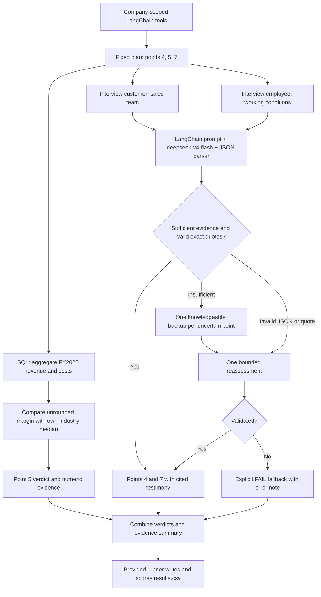

# FTEC5660 Homework 3: Fisher's 15-Point Investment Agent

Build a LangChain agent that researches a company with tools and applies the
framework from Philip Fisher's *Common Stocks and Uncommon Profits* (Part One,
Chapter 3 "What to buy: the fifteen points to look for in a common stock", and
Chapter 4 "What to buy: applying this to your own needs"). You choose 3 of
Fisher's 15 points and decide yourself what PASS means for each. For every
company your agent gives a PASS/FAIL verdict on your 3 points and a short
summary.

The companies are fictional, so the model cannot answer from memory. Unlike a
pile of reports, the evidence is spread over three sources, and your agent has
to go and get it with tools, the way Fisher's "scuttlebutt" method sends an
investor to talk to customers, competitors, suppliers and staff.

## Data and tools

`public_test/` has one folder per company. Your code receives four tools per
company (built by the provided code in `hw3.py`):

| Tool | What it gives you |
| --- | --- |
| `list_documents()` | the company's six documents and their dates |
| `read_document(name)` | one document: the 2025 letter to shareholders, four earnings calls (Q3 2025 to Q2 2026) and a news file (July 2025 to July 2026) |
| `sql_query(query)` | one read-only SQLite query on the company's database; at most 50 rows come back, so use `SUM`, `GROUP BY` and `WHERE` |
| `interview(role, topic)` | what one person says about the company; at most **10 interviews per company** |

The documents are what management says. Management's own claims (such as "we
have never cut research" or "our people are our greatest strength") are not
evidence on their own: check them against the database and the interviews.

**Database tables** (amounts in USD thousands; dates `YYYY-MM-DD`, months
`YYYY-MM`, quarters like `2025Q3`; the fiscal year is the calendar year):

| Table | Columns |
| --- | --- |
| `company` | name, industry |
| `industry_medians` | industry, revenue_growth_2y_pct, new_product_share_pct, new_product_sales_per_rd, operating_margin_pct (one row per industry; use the row for the company's own industry) |
| `orders` | order_id, order_date, product, customer, amount, note (about 3,000 to 4,000 orders from January 2023 to June 2026; revenue is the sum of order amounts) |
| `products` | product, launch_date |
| `monthly_costs` | month, cost_of_sales, selling_admin, research_development |
| `quarterly_cash` | quarter, operating_cash_flow, capex, cash_end |
| `capex_plan` | year, planned_capex (2026 to 2028) |
| `returns` | month, units_shipped, units_returned |
| `insider_trades` | trade_date, person, title, side (`buy` or `sell`), shares, price |

**Terms used in the data.**

| Term | Meaning |
| --- | --- |
| FY2025 | Fiscal year 2025. Here the fiscal year is the calendar year, so FY2025 is January to December 2025. |
| Quarter | Three months of the year: Q1 is January to March, Q2 April to June, Q3 July to September and Q4 October to December. The database writes `2025Q3`; the documents write "third quarter 2025". |
| Amounts | The database is in **USD thousands** (676,100 means US$676.1 million). The documents use USD millions. |
| Revenue | Money from sales: the sum of `amount` in `orders`. |
| Cost of sales | The cost of making the products that were sold. |
| Selling and admin | The cost of selling and of running the company (sales staff, offices, management). |
| R&D | Research and development spending, mainly on new products. |
| Operating margin | Operating profit as a share of revenue: (revenue − cost of sales − selling and admin − R&D) ÷ revenue. |
| Operating cash flow | Cash that the day-to-day business brings in during a quarter. |
| Cash at the end of a quarter | The cash the company holds on the last day of that quarter (`cash_end`). |
| Capex | Capital expenditure: spending on factories, machines and other long-term assets. `capex_plan` holds the planned capex for 2026 to 2028. |
| Return rate | Units returned ÷ units shipped, from the `returns` table. |
| Industry median | The middle value for companies in the same industry, from `industry_medians`. |
| Insider | A director or senior manager of the company. `insider_trades` lists the shares they bought (`buy`) or sold (`sell`). |
| Earnings call | A meeting each quarter where management presents the quarter's results to investors. Each call quotes that quarter's revenue. |

**Interviews.** Roles: `customer`, `current_employee`, `former_employee`,
`competitor`, `supplier`. Topics: `sales_team`, `working_conditions`,
`top_management`, `decision_making`, `competitive_edge`. Only some people know
about each topic; the others say they can't comment, and that answer still
uses up one interview.

| Topic | Who knows about it |
| --- | --- |
| `sales_team` | customer, competitor |
| `working_conditions` | current_employee, former_employee |
| `top_management` | former_employee, supplier |
| `decision_making` | supplier, customer |
| `competitive_edge` | competitor, customer |

People who know about a topic always agree with each other, so one good answer
is enough.

## Choose your 3 points and your rules

Pick any 3 of Fisher's 15 points and write them in `CHOSEN_POINTS` near the
top of `hw3.py`, e.g. `CHOSEN_POINTS = [1, 7, 15]`. The full questions are in
`FISHER_POINTS` in `hw3.py` and in the book.

| # | Fisher's point | Where the evidence is |
| --- | --- | --- |
| 1 | Market potential for sales growth | database |
| 2 | New products as current lines mature | database |
| 3 | Effective research and development | database |
| 4 | Above-average sales organization | interviews (`sales_team`) |
| 5 | Worthwhile profit margin | database |
| 6 | Maintaining or improving margins | database |
| 7 | Labour and personnel relations | interviews (`working_conditions`) |
| 8 | Executive relations | interviews (`top_management`) |
| 9 | Depth of management | interviews (`decision_making`) |
| 10 | Cost analysis and accounting controls | earnings calls, checked against the database |
| 11 | Advantage over competitors | interviews (`competitive_edge`) |
| 12 | Long-range outlook on profits | database |
| 13 | Growth without dilutive equity financing | database |
| 14 | Management talks freely about troubles | earnings calls, checked against the database |
| 15 | Management of unquestionable integrity | news file, checked against the database |

For each of your points, **you design the rule**: which evidence to use, what
to compute or whom to ask, and where the line between PASS and FAIL lies. PASS
means the company looks favourable on that point, as Fisher would see it.

We grade your verdicts against our own answer key. It uses one fixed rule per
point, which we do not publish, and the data never puts a company close to
the line of that rule, so a sensible reading of Fisher usually gives the same
answer. **Test your rules on the public answers**:
`public_test/ground_truth.json` gives the expected verdict on all 15 points
for each of the 20 public companies, and every point fails in 6 of them. If
your rule disagrees with the public answers, rethink it.

**Tip: calculate with tools, not in your head.** Do every sum, ratio and
comparison in SQL or Python, including the number of days between two dates
(SQLite's `julianday()` gives a date as a number of days).

## Student task

Fill in the three places in `hw3.py` marked `### YOUR CODE HERE`. You may add
imports, constants and helper functions above them, but do not change the
provided code below them:

- `CHOSEN_POINTS` lists your 3 points.
- `build_agent()` creates your model and anything else you need once.
- `analyze_companies(agent, companies)` receives
  `{company_folder: [list_documents, read_document, sql_query, interview]}`
  and returns, for every company,
  `{"points": {1: "PASS", 7: "FAIL", 15: "PASS"}, "summary": "..."}` (here with
  `CHOSEN_POINTS = [1, 7, 15]`).

Use the course techniques that fit your points: tool use for the database and
the interviews, planning which interviews to spend, routing each point to the
right source, prompt chaining, parallel calls, reflection to check your
answers, or a combination. Your code must read company data **only through
the four tools**; do not open `company.db` or `interviews.dat` yourself. Do
not hard-code folder names, company names or the public answers.

## Setup and public test

```bash
python3 -m venv .venv
source .venv/bin/activate
pip install -r requirements.txt
echo "DEEPSEEK_API_KEY=your_key_here" > .env
python3 hw3.py --data-folder public_test
```

Use your own DeepSeek API key (from https://platform.deepseek.com). The
required model is `deepseek-v4-flash`. We grade with our own key, so never put
a key in your code; `.env` must stay out of git.

The program creates `results.csv` with the columns `company`, `points`,
`points_correct`, `point_errors`, `interviews_used` and `summary`, and prints
the point score on your 3 points (the percentage after "balanced"). The point
score is the average of two shares: the share of truly passing verdicts that
you marked PASS and the share of truly failing verdicts that you marked FAIL.
For example, 90% and 60% give (90% + 60%) / 2 = 75%, and marking every point
PASS gives (100% + 0%) / 2 = 50%. Once `CHOSEN_POINTS` is set, the starter
runs before you add any API code (it returns no verdicts, so it scores 0%).

`public_test/ground_truth.json` gives the expected verdicts on all 15 points
for each public company. Grading uses a private set of about 20 unseen
companies with the same tools and the same answer key rules, but different
names and wording, and scores your 3 points only.

## Homework 3 solution

**SUN Xianwang | Individual homework**

### My 3 points and rules

I choose **4 (sales organization), 5 (profit margin), and 7 (labour relations)**. Together they test customer-facing execution, financial economics and the treatment of employees. They also require two different forms of reasoning: interpreting testimony and calculating a financial ratio.

| Point | Why this point / PASS rule | Evidence and implementation |
| --- | --- | --- |
| **4: Sales organization** | Skilled sales support can turn products into repeat business. PASS when an informed outsider describes knowledgeable, helpful salespeople who solve problems, earn trust or support customers beyond taking orders; FAIL for passive, unreliable or unhelpful selling. | Interview `customer` about `sales_team`; use `competitor` only if evidence is insufficient. The LLM interprets the testimony in context. |
| **5: Profit margin** | Sales growth is not enough if little operating profit remains. PASS when FY2025 operating margin is **positive and at least the median for the company's own industry**; otherwise FAIL. | One `sql_query` aggregates FY2025 revenue and all three operating cost categories, joins the correct industry median, and makes the comparison in SQL. |
| **7: Labour relations** | Fair treatment and retention support durable execution. PASS for informed testimony of fair treatment, manageable workloads, responsive management or stable retention; FAIL for continuing overwork, unfair treatment, ignored grievances or persistent turnover. | Interview `current_employee` about `working_conditions`; use `former_employee` only if evidence is insufficient. |

These rules follow Fisher's emphasis on asking customers and competitors about selling, comparing operating economics, and examining how employees are actually treated [1, Part One, Chapter 3, points 4, 5 and 7; printed pp. 59–67]. They are **my operational rules for this exercise**, not numerical thresholds claimed to have been specified by Fisher. In particular, Fisher recommends reviewing margins over several years and recognises growth-investment exceptions. My FY2025 median rule is a deliberately narrower, transparent proxy using the latest complete calendar year in the supplied data. It does not capture those exceptions.

The margin calculation is `(SUM(revenue) - SUM(cost_of_sales + selling_admin + research_development)) / SUM(revenue) * 100`. Revenue and costs are aggregated independently before joining, avoiding the multiplication of order and cost rows. Amounts remain in USD thousands, so units cancel. The SQL `CASE` uses unrounded values; the tool's two-decimal display cannot alter a boundary decision. Twelve cost months and positive revenue are required before accepting the calculation.

### Design



This is a **planned LangChain workflow**: Python routes each point to its appropriate company-scoped tool, while a reusable `ChatPromptTemplate | ChatDeepSeek | JsonOutputParser` chain interprets the qualitative evidence. The model does not choose arbitrary tools or perform arithmetic. Three companies can run concurrently. A normal company needs one SQL call, two interviews and one model call. If testimony is insufficient, the workflow asks a knowledgeable backup and reassesses once, using at most four interviews, below the limit of ten. Invalid JSON or unsupported quotations trigger one repair attempt using already collected evidence. The final summary combines SQL evidence with the model's explanation and validated interview quotation. Sources are treated as data, not instructions; the system prompt rejects embedded requests to change rules. Exact-quote checks ensure traceability but do not prove the interpretation is correct.

The workflow deliberately does not read management documents: none of the three selected criteria needs an unsupported management claim. All company evidence comes exclusively from the supplied `sql_query` and `interview` tools. The solution does not read `company.db`, `interviews.dat`, company documents or answer keys directly, and does not use web search. The provided runner still loads tools and scores the public answer key as intended. Company/folder names are used only as output identifiers, not decision features.

Model settings are `deepseek-v4-flash`, temperature 0, non-thinking mode, JSON output, 1,600 output tokens, a 45-second API timeout and no hidden client retries. There are at most two model calls per company and an overall 150-second company deadline. With 20 companies and concurrency three, the scheduled deadline budget is at most 17.5 minutes plus normal runner overhead. On an unresolved operational error, the code preserves any independently obtained verdict and returns explicit **FAIL fallback** entries for unavailable points so that the batch can finish. The summary labels these as operational/insufficient-evidence fallbacks, not verified adverse findings. This convention can create false negatives; a production system should instead expose an abstain/review state.

### Results

The first two full public runs each produced **60/60 correct point decisions and balanced accuracy 100.0%**. For the 20 companies and three selected points, all **42 expected PASS** and **18 expected FAIL** decisions were correct. Each run used exactly **two interviews per company**, with **zero operational fallbacks**. The second run completed in **12.84 seconds** on the test machine; timing will depend on API availability.

There were **no disagreements with the public answers**, so there are no mismatch-specific explanations to report. The fixed rules and point choices were established before checking the first scored run; no company-specific exceptions were added. `evaluation/public_run1.csv` and `evaluation/public_run2.csv` preserve every verdict and evidence summary. The third run, from a fresh Git clone, also achieved **60/60 and balanced 100.0%**, completing in **12.98 seconds**. See `evaluation/public_run3_fresh_clone.csv` and `evaluation/fresh_clone_check.json`. All three runs agree on every verdict; their mean balanced score is **100.0%**. The fresh clone also passed all seven offline tests.

For example, **Ashgrove Labs** is FAIL on points 4 and 7: its customer's statement describes order-taking without useful advice, while its employee reports constant overtime and turnover. It is PASS on point 5, with FY2025 operating margin **13.36%**, above its industry median **9.40%**. These different verdicts show why a favourable financial ratio should not erase negative stakeholder evidence.

Seven offline tests cover margin boundaries, own-industry selection, incomplete financial evidence, normal interview budgets, uncertainty-driven backup routing, API outages, fabricated quotation rejection and isolation of SQL failures. Run them with `python -m unittest discover -s tests -v`. They use only synthetic in-memory data and mock tools, never the real company files or public labels.

Public performance is not a private-test guarantee. The interview language in the public data is relatively direct, and real-world sources can conflict, omit context or be biased. Temperature zero does not guarantee deterministic model service behaviour. Chapter 4 of Fisher also makes the investor's circumstances and ability to investigate relevant; passing these three checks is neither a full fifteen-point assessment nor a suitability or buy recommendation.

### Reproducibility and acknowledgement

Use the setup commands above, create your own untracked `.env`, then run `python hw3.py --data-folder public_test`. The original tool, runner and scoring section of `hw3.py` is unchanged. Tested direct dependency versions are recorded in `evaluation/environment.json`; the starter's dependency ranges are retained. No API key is stored in code, notebook output or results.

ChatGPT (OpenAI) assisted with interpreting the assignment, designing and implementing the workflow, debugging and testing, and drafting this report and the reflection. The required runtime model for company judgments is DeepSeek's `deepseek-v4-flash` through LangChain. Public scores and examples above come from actual executions, not estimated results.

### References

1. Philip A. Fisher, *Common Stocks and Uncommon Profits and Other Writings*, Part One, Chapters 3 and 4. [Course-provided book](https://drive.google.com/file/d/1v2nMaz9pjnrCtMwB1kLWod4uOBJYmJiV/view). Especially points 4, 5 and 7, printed pp. 59–67; Chapter 4, pp. 79–88.
2. [Instructor's Homework 3 starter and specification](https://github.com/BINH2702/FTEC5660-HW3), upstream commit `5fa8c373434c5aa6ee7c681248edeb900f7a1211`.
3. [LangChain ChatDeepSeek reference](https://reference.langchain.com/python/langchain-deepseek/chat_models/ChatDeepSeek), [DeepSeek JSON output](https://api-docs.deepseek.com/guides/json_mode/) and [thinking-mode controls](https://api-docs.deepseek.com/guides/thinking_mode/), accessed 16 November 2026. These implementation references are not sources of company evidence.
